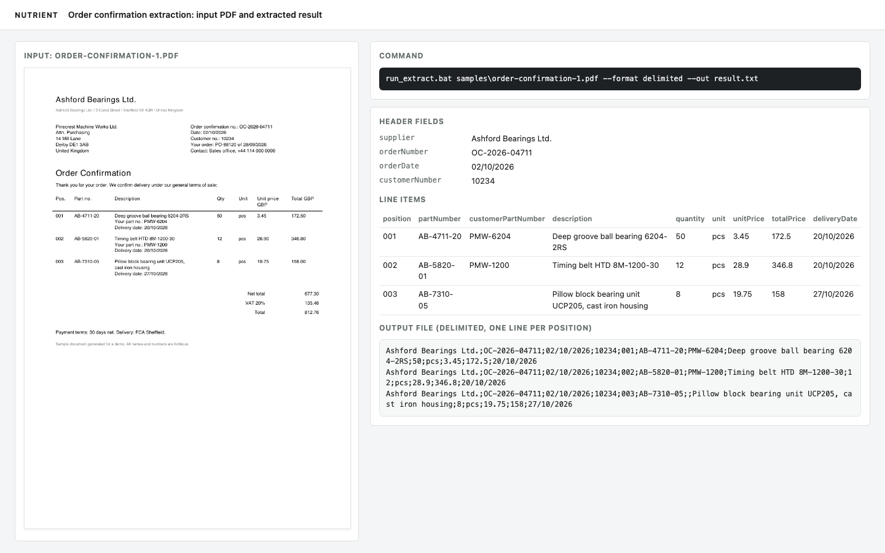
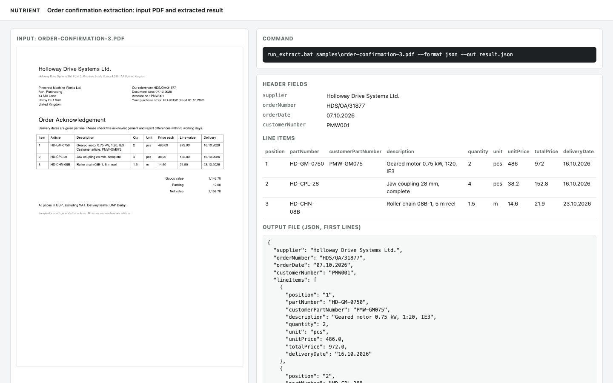

# Nutrient Order Confirmation Extraction

A Nutrient.io demo that reads a supplier's order confirmation PDF on a local PC and returns the header fields and every line item as JSON, CSV or a delimited text file that an ERP can import.



1. **Input.** A PDF order confirmation, digital or scanned.
2. **Read.** The Nutrient Python SDK runs its ICR vision model on every page to get the text and the layout, including item tables without ruling lines.
3. **Extract.** The SDK structured extraction sends the text, the JSON schema in `schema.json` and the instructions in `extract_order.py` to a local LLM served by Ollama. Schema-constrained decoding forces valid JSON.
4. **Tidy.** If the model leaves a customer part number line or a delivery date line inside a description, the tool moves it to `customerPartNumber` or `deliveryDate`.
5. **Output.** JSON, CSV or one delimited line per position with the header fields repeated on every line. The exit code is 0 on success and 1 on error, with one error line on stderr.

Everything runs on the local PC. Internet access is only needed once, to install Python, the Nutrient SDK, Ollama, the model and the Nutrient vision models.

The schema and the instructions name the usual English labels and their German equivalents (for example "Order confirmation no." and "AB-Nr."), so the same tool reads order confirmations in both languages. Dates and calendar weeks are copied exactly as printed, numbers are returned with a dot as decimal separator.

## Prerequisites

- Python 3.12 or later, 64-bit
- Windows x64, macOS on Apple Silicon or Linux x64 (the Nutrient Python SDK native runtimes)
- [Ollama](https://ollama.com/download) with `qwen2.5:7b-instruct` (16 GB RAM recommended) or `qwen2.5:3b-instruct` (8 GB RAM, faster but less accurate). A GPU is not required.
- About 1 GB of disk space for the Nutrient vision models, downloaded on the first run

## Environment variables

Copy `.env.example` to `.env`, or set the variables in the system settings on Windows. The command line options `--endpoint` and `--model` override the last two.

| Variable | Purpose | Default |
|---|---|---|
| `NUTRIENT_LICENSE_KEY` | Nutrient Python SDK license key | empty = evaluation mode |
| `AI_ENDPOINT` | OpenAI-compatible endpoint of the local model server | `http://localhost:11434/v1` |
| `AI_MODEL` | Model used for the extraction | `qwen2.5:7b-instruct` |

In evaluation mode the SDK prints a notice and each process is time-limited to one hour, which is enough for a command line run. The tool sends the SDK's console messages to stderr, so stdout only carries the result.

## Build and run

### macOS and Linux

```bash
python3 -m venv venv
```

```bash
venv/bin/pip install -r requirements.txt
```

```bash
ollama pull qwen2.5:7b-instruct
```

```bash
./run_extract.sh samples/order-confirmation-1.pdf --format delimited
```

To use the values from `.env`, load them first with `set -a && source .env && set +a`.

### Windows

In a Command Prompt, in the folder of this repository:

```bat
python -m venv venv
```

```bat
venv\Scripts\pip install -r requirements.txt
```

```bat
ollama pull qwen2.5:7b-instruct
```

```bat
run_extract.bat samples\order-confirmation-1.pdf --format delimited
```

Expected output, one line per position:

```text
Ashford Bearings Ltd.;OC-2026-04711;02/10/2026;10234;001;AB-4711-20;PMW-6204;Deep groove ball bearing 6204-2RS;50;pcs;3.45;172.5;20/10/2026
Ashford Bearings Ltd.;OC-2026-04711;02/10/2026;10234;002;AB-5820-01;PMW-1200;Timing belt HTD 8M-1200-30;12;pcs;28.9;346.8;20/10/2026
Ashford Bearings Ltd.;OC-2026-04711;02/10/2026;10234;003;AB-7310-05;;Pillow block bearing unit UCP205, cast iron housing;8;pcs;19.75;158;27/10/2026
```

### Offline use

Download the Nutrient vision models once while the PC is online:

```bash
venv/bin/python -c "import nutrient_sdk as ns; d = ns.Document.open('samples/order-confirmation-1.pdf'); d.settings.vision_settings.engine = ns.VisionEngine.ICR; ns.Vision.set(d).warmup(); d.close(); print('models ready')"
```

On Windows, use `venv\Scripts\python`; the path works as written. After that the PC can be offline. The tool only talks to the model server on `localhost`, so a firewall rule that blocks outbound traffic for `python` and `ollama` does not stop it.

## Using the tool

```bash
./run_extract.sh input.pdf --format json --out result.json
```

| Option | Description |
|---|---|
| `--format json\|csv\|delimited` | Output format. Default `json` |
| `--separator ";"` | Separator for `delimited`. Default `;` |
| `--out FILE` | Write to a file instead of stdout |
| `--endpoint URL` | OpenAI-compatible endpoint. Default `AI_ENDPOINT` |
| `--model NAME` | Model name. Default `AI_MODEL` |
| `--schema FILE` | JSON schema. Default `schema.json` next to the script |
| `--confidence` | Adds a `metadata` node with a confidence score and source position per field (JSON only) |
| `--no-strict` | Turns off schema-constrained decoding, for model servers that reject `response_format` `json_schema` |

Field order of every delimited or CSV line:

```text
supplier;orderNumber;orderDate;customerNumber;position;partNumber;
customerPartNumber;description;quantity;unit;unitPrice;totalPrice;deliveryDate
```

CSV and delimited files are UTF-8 with a byte order mark and CRLF line ends. JSON is UTF-8.



Errors exit with code 1 and one line on stderr, for example `error: model endpoint unreachable at http://localhost:11434/v1`. Ollama serves one request at a time and the SDK gives up after about 2 minutes of waiting, so run one extraction at a time per model server.

To support a new supplier layout, add its wording to the descriptions in `schema.json`, for example the exact column header used for the article number.

See [docs/powerbuilder.md](docs/powerbuilder.md) for calling the tool from a PowerBuilder application.

## Tests

```bash
venv/bin/python tests/run_samples.py
```

The script extracts every PDF in `samples/`, writes one JSON and one delimited file per sample to `samples/output/`, and prints a summary with the number of items, the number of empty fields and the time per file. It accepts the same options as the tool, for example `--model qwen2.5:3b-instruct`.

## Samples

`samples/order-confirmation-1.pdf` to `order-confirmation-3.pdf` are fictitious order confirmations with three layouts: a table without ruling lines and multi-line positions, prices per 100 pieces with calendar weeks, and a ruled table with a delivery date column. To regenerate them:

```bash
pip install -r samples/requirements.txt
```

```bash
python samples/generate_samples.py
```
